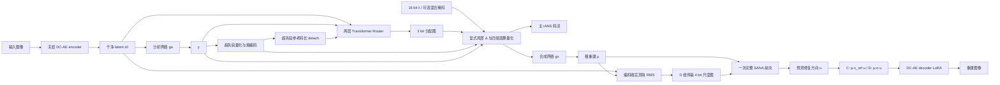

# BT-SelfFlow v1：实现、启动与验收

实现分支：`codex/bt-self-flow-v1-20261015`；基线提交：`7d3323abd54187d48dd9256bd7c938007de6f800`。
工作区：`/data2/ls/code/DiT-IC-bt-self-flow`。原工作区保留。
设计依据：[完整方案 v2](/data2/ls/BT_SelfFlow_完整方案_20261015.md)。

## 实现范围与边界

| 模块 | 实现位置 | 行为 |
|---|---|---|
| 分配与显式量化 | `models/bt_self_flow/router.py`、`codec.py` | 两层 Transformer；3 bit 分配；四组因果上下文、LRP 和真实 rANS 共用量化规则 |
| 自包含码流 | `models/bt_self_flow/packet.py` | 版本、尺寸、16 bit λ、各载荷长度、超先验、主码流、分配图、可选尺度和混合掩码 |
| 实测失真尺度 | `models/bt_self_flow/scale.py`、`validation.py` | 编码端由真实恢复 μ 测 RMS；固定训练集标定；4 bit log 尺度；停止梯度 |
| C/D 单步后端 | `models/bt_self_flow/model.py`、`conditioning.py` | 原固定时间更新 / 连续失真条件和局部尺度更新；完整 SANA、1 NFE |
| 内存控制 | `models/bt_self_flow/decoder.py`、`models/sana_self_flow.py` | 支持 SANA / DC-AE decoder 检查点；C/D 实测后关闭重算加速，D_mix/E 开启 |
| 混合精度稳定性 | `models/bt_self_flow/precision.py` | 投影保持 AMP；SANA / DC-AE 注意力乘法与归一化明确 FP32，避免 FP16 分母下溢 |
| 训练与恢复 | `train_bt_self_flow.py`、`checkpoint.py`、`data.py` | 分阶段优化、DDP 累积、辅助 quantile 优化器、部署 EMA、完整恢复、独立数据随机流 |
| 真实评测 | `eval_bt_self_flow.py` | 保存实际包、从序列化包解码、完整字节计费、图像指标、耗时、NFE 和诊断 |
| 后续 Self-Flow | `model.py`、独立 E 配置 | 同架构 EMA 教师前 20 层；学生第 8 层表征，完整学生生成最终输出 |

这里的尺度是**测得的压缩失真标签**，不宣称量化误差经加噪后严格成为高斯流状态。SANA 的原生时间保持固定。新协议使用独立方法标识 `bt_self_flow_v1`，拒绝把旧 checkpoint 当成新模型加载。

全局 λ 连续控制量化公式，码流中使用 16 bit 恢复值；实际文件码长因符号取整和字节封装呈阶梯变化。不承诺单张图每次增大 λ 都严格增加实际字节数。当前不增加“零比特跳过 token”机制。

## 计算路径



解码只需要包和对应 checkpoint / 公共预训练权重，不运行 Router。C 无尺度图，D/E 部署为 D 包。512×512 图像的 y 网格是 8×8：分配图 24 字节，D 尺度图 32 字节，固定头 55 字节；这些开销均计入实际 bpp。

## 环境与测试

```bash
cd /data2/ls/code/DiT-IC-bt-self-flow
export TORCH_HOME=/data2/ls/checkpoints/torch-hub
export HF_HOME=/data2/ls/checkpoints/hf-cache
export OMP_NUM_THREADS=1
export OPENBLAS_NUM_THREADS=1
export GLOO_SOCKET_IFNAME=lo
/data2/ls/code/venvs/ditic/bin/python -m pytest tests -q -p no:cacheprovider
```

GPU 资源预检会写 JSON。`--smoke` 进一步使用真实公共权重、512 裁剪、完整损失和有效 batch 8，执行共同前端及 C/D 直接联合训练的短跑，包含暂停/恢复和实际包验证。

```bash
/data2/ls/code/venvs/ditic/bin/python scripts/preflight_bt_self_flow.py \
  --gpus 0,1 --smoke --output /data2/ls/checkpoints/bt_preflight_gpu_01
```

每个短阶段 14 个 optimizer updates，后 4 个更新用于估计吞吐。短跑只验证工程路径，不能用作 C/D 研究结果。输出目录必须独立且全新。CUDA 不可访问时退出码为 2，不加载大模型执行训练。

**2026-10-15 更新：**数据、SANA/DC-AE、文本 embedding 均存在。用户随后授权停止旧 GPU0/1 baseline，并切换新 C/D。旧任务已正常退出，可用 checkpoint 保留；停止记录及本轮完整 GPU 验收见 [复核记录](BT_SELF_FLOW_REVIEW_20261015.md)。早期 `/data2/ls/checkpoints/bt_self_flow_v1_host_readiness_20261015/preflight.json` 记录的是授权切换前的资源状态。

小型实际 V100 检查已通过：C/D 各完成两个生产训练入口的 FP16 optimizer updates；真实包与硬前向的图像误差均为 0，均为 1 NFE。该检查峰值分配约 179MiB，**不代表完整网络的显存需求**。报告在 `/data2/ls/checkpoints/bt_self_flow_v1_gpu_microcheck_20261015.json`。CPU 测试还覆盖小型真实 AutoencoderDC、独立 rANS 解码、断点恢复和双进程主/辅助优化器同步。DDP 测试需要主机上正常可用的本地 loopback。

完整回归：**114 项通过，0 失败、0 跳过**；JUnit 报告位于 `/data2/ls/checkpoints/bt_self_flow_v1_validation_20261015/tests.xml`。此外已在 CPU 加载真实公共权重，核对 C/D 共享初始化完全一致，并完成 D 的完整 28 层、512×512 硬前向与码流解码，最大图像误差 `2.93255e-5`（容差 `2e-4`）、1 NFE。全规格 CPU 报告位于 `/data2/ls/checkpoints/bt_self_flow_v1_public_cpu_check_20261015.json`。该检查使用未训练前端与单裁剪工程标定，不是训练 checkpoint 或率失真结果。

真实 LPIPS AlexNet / DISTS 权重的图像梯度已在 CPU 与物理 GPU 1 核验为有限且非零，见 `/data2/ls/checkpoints/bt_self_flow_v1_validation_20261015/perceptual_loss.json`。DISTS 直接使用可微网络，避免 pyiqa 0.1.16 推理包装器残留的设备标记破坏 `.to()` 迁移。

另有一项评测入口集成检查通过，报告为同目录的 `evaluation_tests.xml`：覆盖实际文件字节/占比计费、原尺寸 bpp、硬前向检查，以及移走原始图像目录后，仅凭包与 checkpoint 在新模型实例中解码；独立解码不构建感知网络。

## 两卡主实验

以下命令按阶段执行。实际 GPU 编号可替换；不自动占用/终止已有任务。

```bash
# 共同 codec：两卡、每卡 microbatch 2、累积 2，50k updates。
bash scripts/run_bt_self_flow.sh codec 0,1

# 完成共同前端、训练集尺度标定和真实码率跨度检查后，生成一次共享初始化。
bash scripts/run_bt_self_flow.sh prepare 0

# 随后分别在两个终端启动；每组单卡、microbatch 2、累积 4。
bash scripts/run_bt_self_flow.sh C 0
bash scripts/run_bt_self_flow.sh D 1
```

默认输出根目录 `/data2/ls/checkpoints/bt_self_flow_v1`；另一次实验通过 `BT_RUN_ROOT=/新的目录` 覆盖，所有阶段保持一致。共同前端 50k 结束并完成训练集尺度标定后，`C` / `D` 从同一份 `backend_init.pt` 各直接进入 **200k 端到端训练**，无独立冻结适配阶段。前端、Router、主熵模型、SANA LoRA、文本投影及 DC-AE decoder LoRA 从第一步共同更新；D 的尺度调制和局部尺度更新从第一步完整启用。旧 `*_backend.yaml` 仅用于明确恢复旧阶段，不被主实验启动器调用。

也可在 tmux 中执行 `python scripts/launch_bt_pair.py --root /data2/ls/checkpoints/bt_self_flow_v1 --gpus 0,1` 自动衔接全部阶段。该入口固定已提交的代码与配置、按 checkpoint 恢复，记录 `pipeline.json` / `manifest.json`，并将 C 放 GPU0、D 放 GPU1。共同前端尚未完成时，两组后端处于等待状态。

共同前端前 2k 使用参考质量、均匀分配；再 3k 打开 λ 范围与 Router。SANA 不参与此阶段。完成后固定六个质量点的训练集标定。必须得到至少三个不同的实际总码率点，才允许生成共享后端初始化；这项检查只确认形成码率跨度，质量是否有效仍需检查验证曲线。

正式配置还要求标定集合的高质量端相较低质量端具有更高实际码率和更低粗 latent NMSE，否则停止阶段衔接。完整 GPU 验收与速度记录见复核文档：最终 C/D 均使用 bs2、累积4，关闭重算后联合训练约 4.53/4.57 秒每更新，峰值分配 22.59/23.50 GiB。

C/D 均使用 SANA LoRA 128/128、DC-AE decoder-only LoRA 32/32、可训练文本投影；DC-AE encoder 与两个公共底座冻结。不构造 GAN 判别器。C/D 的共享初始参数、数据顺序、裁剪和 λ 采样相同。

Ampere 及更新 GPU 使用原生 BF16；V100 使用 FP16＋GradScaler。AMP 溢出重试复用同一组 CPU batch，不改变 C/D 的数据顺序，也不把跳过的更新计入预算。codec / 熵路径和注意力归一化保持 FP32。

训练日志中 `rate_est` 是“似然估计＋确定侧信息”，不是实测码率。各阶段每 2k 保存完整恢复点，并用全部 24 张 Kodak 原图验证，六档平均验证率失真损失变好时更新 `best.pt` / `best.json`。验证的 `rate_actual` 包含完整码流字节，选择 best 时使用实际码率；D 也计入尺度图。图像独立解码一致性检查只在完整过渡后执行。阶段开始重建优化器和 LR 调度，恢复训练则恢复全部状态。最终等步数比较使用 `complete.pt` 的 decay=0.999 部署 EMA，best 作为补充。

按实测完整 optimizer-update 秒数估算 50k 共同前端加两组并行 200k 的预算。每组有效 batch=8（bs2、累积4），主优化器前 500 步仅做学习率 warmup，所有训练模块同时更新；随后按完整 200k 余弦下降至初始 LR 的 0.1。新联合阶段每 2k 保存，保留最近三个数字恢复点及历史 best 对应的恢复点，`paused.pt` / `complete.pt` 不受清理影响。已有共同前端恢复点不清理。默认量化端点、码率惩罚、损失和数据不变，参数在 `configs/bt_self_flow/`。

## 暂停与恢复

SIGINT/SIGTERM 在完整更新边界保存 `paused.pt`；`--max-updates` 可在指定已完成更新数暂停，不修改原预算。强制 kill 或进程异常不会伪造完整更新 checkpoint；可以从最近的定期 checkpoint 恢复。

恢复必须直接运行训练入口，使用对应阶段配置和原输出根目录；不要把 `--resume` 传给自动串阶段脚本。

```bash
CUDA_VISIBLE_DEVICES=1 /data2/ls/code/venvs/ditic/bin/python train_bt_self_flow.py \
  --config configs/bt_self_flow/d_joint.yaml \
  --resume /data2/ls/checkpoints/bt_self_flow_v1/D/joint/paused.pt

CUDA_VISIBLE_DEVICES=0,1 /data2/ls/code/venvs/ditic/bin/python -m torch.distributed.run \
  --standalone --nproc_per_node=2 train_bt_self_flow.py \
  --config configs/bt_self_flow/common.yaml \
  --resume /data2/ls/checkpoints/bt_self_flow_v1/common/paused.pt

# 共同前端完成并生成共享初始化后，直接开始 joint：
CUDA_VISIBLE_DEVICES=1 /data2/ls/code/venvs/ditic/bin/python train_bt_self_flow.py \
  --config configs/bt_self_flow/d_joint.yaml \
  --init-checkpoint /data2/ls/checkpoints/bt_self_flow_v1/backend_init.pt
```

checkpoint 保存 raw/EMA、主/辅助优化器、调度器、scaler、阶段/实际更新数、每 rank RNG、已消费的数据位置、标定、完整配置与公共权重 SHA256。恢复会核对配置、数据文件列表指纹、资产与 world size，避免悄悄换实验。

## 真实码流评测

比较两组相同步数的联合 checkpoint，并在 200k 结束后统一使用 `complete.pt` 的部署 EMA；best 作为补充。Kodak 使用原尺寸、右/下 pad 到 256 倍数并裁回，bpp 分母是原图像素数。

```bash
CUDA_VISIBLE_DEVICES=0 /data2/ls/code/venvs/ditic/bin/python eval_bt_self_flow.py \
  --checkpoint /data2/ls/checkpoints/bt_self_flow_v1/C/joint/complete.pt \
  --input /data2/ls/data/Kodak --output /data2/ls/checkpoints/bt_eval/C_joint \
  --check-forward --save-images

CUDA_VISIBLE_DEVICES=1 /data2/ls/code/venvs/ditic/bin/python eval_bt_self_flow.py \
  --checkpoint /data2/ls/checkpoints/bt_self_flow_v1/D/joint/complete.pt \
  --input /data2/ls/data/Kodak --output /data2/ls/checkpoints/bt_eval/D_joint \
  --check-forward --save-images

/data2/ls/code/venvs/ditic/bin/python scripts/compare_bt_self_flow.py \
  --c /data2/ls/checkpoints/bt_eval/C_joint/summary.json \
  --d /data2/ls/checkpoints/bt_eval/D_joint/summary.json \
  --output /data2/ls/checkpoints/bt_eval/comparison_joint
```

评测默认六个 λ，写出每图 `.btic`、指标 JSONL 和汇总 JSON：真实总 bpp、各载荷字节与占比、PSNR/LPIPS/DISTS、编/解码时间、峰值显存、NFE、粗 latent MSE、修复 RMS、尺度饱和率，以及高精度区域 PSNR。汇总的字节占比按该质量点所有实际包的总字节计算。高精度区域定义为原图区域内恢复 Δ 的下四分位（包含并列项）。`--check-forward` 同时报告估计/实测码长差距。

比较脚本核对数据、步数、阶段、权重和指标协议，在共同实际总 bpp 区间内取三个点，按 log bpp 插值；禁止外推。插值结果需结合原曲线看，不能把相同 λ 当成相同码率。D 的尺度图成本已在横轴内。

独立进程只凭包与模型解码：

```bash
CUDA_VISIBLE_DEVICES=1 /data2/ls/code/venvs/ditic/bin/python eval_bt_self_flow.py \
  --checkpoint /data2/ls/checkpoints/bt_self_flow_v1/D/joint/complete.pt \
  --decode-packet /绝对路径/某张图.btic --output /绝对路径/decoded.png
```

## 后续 D_mix / E

完成 D 后再安排两组等步数续训。默认各 10k，依据剩余算力决定是否启动；不影响当前 C/D 配置。

```bash
bash scripts/run_bt_self_flow.sh D_mix 0
bash scripts/run_bt_self_flow.sh E 1
```

两组都交替使用普通全局质量和**量化前**形成的 25% 高精度混合输入，使用相同数据/质量/掩码序列。E 额外启用 EMA 高码率教师和第 8→20 层对齐。教师由已适配学生初始化，仅训练时存在；学生完整生成最终输出。教师真实 RMS 没优于学生的块不参与对齐，无有效块时损失为零。表征梯度保留到学生 μ、量化步长、Router 与 ga。

表征权重按对 μ 的梯度范数定期标定，目标为重建梯度的 5%、标定时上限 10%；标定间隔内比例可能变化，日志记录实际权重与有效块比例。教师 decay=0.9999，与部署 EMA 分开保存。

代码正确性与研究收益分开：当前测试不证明 D 在支付尺度比特后优于 C，也不证明 Self-Flow 的最终收益。这些结论必须来自完整真实码流实验。
