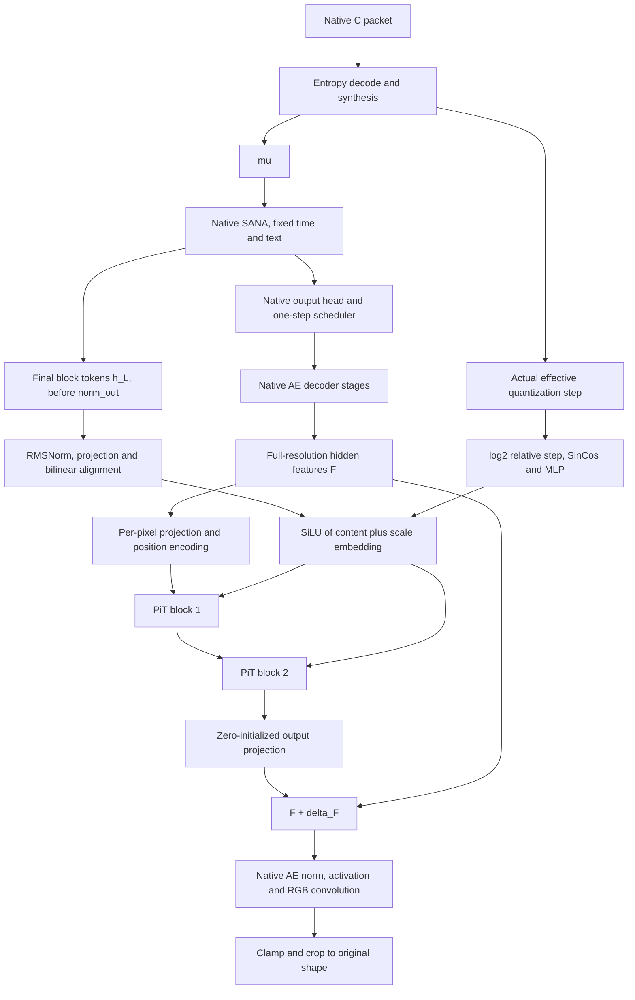

# C With A Two-Block Pixel Decoder Adapter

Implemented on 2026-10-28 (Asia/Shanghai) in
`codex/c-pit-pixel-adapter-20261028`, based on native precision-v2 C commit
`073f54eced8bff354f49f3233da9dca9aee8eccf`.

This experiment is separate from both the old joint X/S decoder and the newer
precision-v3 C experiment. It uses backend C and an unchanged C packet format.
The GPU5 launch on 2026-10-28 reuses the original C experiment's completed,
calibrated 50K warmup and enters joint image training directly. The PiT adapter
has no latent-warmup objective and does not require repeating that stage.

## Architecture



The real local AE has 128 channels at the insertion point. The code determines
this from the loaded decoder rather than assuming a particular AE checkpoint.
The native decoder has the order `up_blocks -> norm_out -> conv_act -> conv_out`;
the adapter updates the result of `up_blocks` before the other three operations.

For a 512x512 image:

| Tensor | Shape |
| --- | --- |
| C effective delta | B x 1 x 8 x 8 |
| SANA final tokens | B x 256 x 1152, with a 16x16 grid |
| AE hidden features | B x 128 x 512 x 512 |
| Pixel state | B x 1024 x 256 x 16 |
| Region conditions | B x 1024 x 256 |
| Compact attention tokens | B x 1024 x 256 |

The two blocks have independent parameters. Each retains the upstream PiT
operation order: per-pixel RMSNorm and modulation, learned compaction,
Q/K RMSNorm, two-dimensional RoPE, softmax SDPA, learned expansion, gated
pixel residual, and a modulated 16->64->16 GELU MLP residual. QKV has no bias;
dropout is zero. There are four attention heads with dimension 64.

The positional conventions follow the pinned official implementation: absolute
pixel SinCos and region RoPE with normalized coordinates from 0 to 16 on each
axis. Both support rectangular images. The original C padding/crop policy is
preserved. No global hooks or stored features from earlier calls are used.

## Conditions And Initialization

The content branch applies RMSNorm and Linear(1152,256) to h_L, then bilinearly
aligns its grid with region tokens using `align_corners=False`.

The scale branch uses `view['delta']` from the actual hard-quantized forward or
packet entropy decode. It never reconstructs delta from an uncentered precision
label. Each 8x8 coding cell is repeated over its 4x4 region coverage. The branch
embeds `log2(delta / delta_ref)`, with fixed `delta_ref=1`, through the upstream
cos/sin frequency convention and a 256->256->256 SiLU MLP.

The fused condition is `SiLU(content + scale_embedding)`. Delta remains a
quantization-control variable, not measured error, confidence or diffusion time.
The new module does not add pixel noise, another timestep or a sampler.

Only Linear(16,128) at the adapter output is initialized to zero. All internal
gates, projections and the two independent PiT blocks use normal initialization.
The first image update trains the output projection; internal paths receive
nonzero gradients after that projection changes. Initialization uses isolated
CPU seed 903 and preserves the native C initialization and RNG sequence.

The adapter adds exactly 17,796,592 parameters for the actual 128/1152-channel
model. It adds neither a second SANA nor extra encoder image reconstruction.

## Training And Deployment Contract

The new decoder method is `sana_conditioned_pixel_adapter_v1`. Configuration
validation requires precision-v2 C, codec/joint phases and disabled Self-Flow.
Legacy C/D and Self-Flow validation is retained. Quantization, symbols, entropy
coding, packet headers and side information have not been changed.

All existing C trainable parameters retain their original policy: codec E2E,
DiT LoRA, decoder AE LoRA and text projection. The AE encoder and the original
non-LoRA backbone weights remain frozen as in C. PiT uses a separate optimizer
group at the existing backend learning rate. C's objective, global gradient
clipping, auxiliary entropy update, optimizer settings and deployment EMA policy
are preserved. There is no Self-Flow teacher or representation loss.

Warmup remains the original latent-only 50K stage and constructs no PiT. Joint
training is configured for 200K steps. Each recipe below explicitly uses single
GPU batch 8, accumulation 1, effective batch 8; data, quality sampling, losses
and learning-rate milestones are inherited from C without editing its recipes.
The original common recipe had a two-rank effective-batch field, so this new
single-GPU recipe overrides that field to 8 as required.

`capture=True` exposes SANA tokens after the last native block/before its head,
and pixel tokens after PiT block 2/before the adapter output projection. These
features retain gradients. Pixel tokens have shape B x N_regions x 256 x 16;
their `token_hw` describes the region grid.

Packet decoding performs one SANA prediction, one native AE pass and two PiT
layers. AE stages and SANA are not run again to obtain features. RGB output
scaling, clamping and crop behavior match the native path.

`pixel_adapter` is included in raw weights, deployment EMA and optimizer state.
Missing PiT weights are rejected on ordinary restore; initialization from a
shared native C backend checkpoint is an explicit stage-handoff operation.
Resume compares the complete optimization contract, including decoder settings,
dataset, batch, world size and pretrained asset identity.

## Entry Points

| Recipe | Purpose |
| --- | --- |
| `configs/bt_self_flow/pixel_adapter/common.yaml` | Common 50K latent warmup |
| `configs/bt_self_flow/pixel_adapter/native.yaml` | Matched native C control |
| `configs/bt_self_flow/pixel_adapter/content_only.yaml` | Two PiTs, fixed reference scale input |
| `configs/bt_self_flow/pixel_adapter/joint.yaml` | Two PiTs, actual quantization scale input |

The content-only control retains the identical scale embedding network and
parameter count, but supplies log-relative scale zero. Full and control can
therefore load the same initial adapter weights.

From this worktree, set the local paths as appropriate before running:

```bash
export DITIC_SANA_PATH=/data2/luosheng/hf_models/hub/SANA_600M_1024px_diffusers
export DITIC_TEXT_PATH="$DITIC_SANA_PATH/fixed_text_embed_gemma.pt"
export DITIC_DATA_ROOT=/data2/luosheng/data/Datasets
export PIT_RUN_ROOT=/data2/luosheng/code/DiT-IC/checkpoints/c_pixel_adapter_v1
python train_bt_self_flow.py --config configs/bt_self_flow/pixel_adapter/common.yaml
python train_bt_self_flow.py --config configs/bt_self_flow/pixel_adapter/joint.yaml \
  --prepare-backend "$PIT_RUN_ROOT/common/complete.pt" \
  --output "$PIT_RUN_ROOT/backend_init.pt" --device cpu
python train_bt_self_flow.py --config configs/bt_self_flow/pixel_adapter/joint.yaml \
  --init-checkpoint "$PIT_RUN_ROOT/backend_init.pt"
```

The commands above are for a new C warmup. If the matched C warmup already
exists, pass its calibrated shared `backend_init.pt` directly to the last
command instead. It must retain the existing calibration and quality/rate-span
checks. Native C and content-only controls use the same shared backend
initialization with their respective recipes. Exact continuation uses the
original `--resume` entry point, not stage initialization.

Evaluation continues through `eval_bt_self_flow.py`, which reads the decoder
method from the checkpoint config. The existing actual-packet validation runs
the new forward and decode paths and still checks their image parity.

## Verification

The source reference is NVlabs/PixelDiT commit
`f7d7c35f71893d81c6e71d2576ea80601a1e8529`; source attribution and the original
license are retained under `third_party/PixelDiT`.

The new tests compare a block's forward, input/condition/parameter gradients,
pixel positions and RoPE directly against that official revision. Additional
checks cover zero initialization, both layers' later gradients, quantization
conditioning, rectangular grids, native SANA equivalence, activation checkpoint
equivalence, two-rank CPU synchronization, strict restore and exact trainer
continuation including raw/EMA weights, optimizer and RNG state.
The constructor also handles a PEFT-wrapped AE RGB convolution without renaming
or replacing it. A separate decoder process verifies checkpoint/packet-only
reconstruction with sender interfaces disabled.

The production pretrained CPU check at 512x512, batch 1, executed two complete
RD/perceptual plus entropy-auxiliary updates. Initial native image difference
and post-update packet/forward image difference were both exactly 0. It included
the real SANA, DC-AE, codec, LPIPS, DISTS and deployment EMA. This is an
engineering check with an untrained codec, not an RD quality result.
Report: `docs/test_reports/pixel_adapter_pretrained_cpu.json`.

The RTX 5090 check exercised the production-width two-layer adapter at 512x512,
batch 1, BF16, with a 1.25 GiB PyTorch allocation limit. Both updates were finite;
both attention layers and content/scale branches had nonzero gradients after
the first update. Peak PyTorch allocation was 1,203,965,952 bytes.
Report: `docs/test_reports/pixel_adapter_5090_bf16_retry.json`.

The production pretrained CPU check also passed at batch 8: two complete
RD/perceptual plus auxiliary updates and actual packet decoding, with both
initial native parity and post-update packet parity exactly 0.
Report: `docs/test_reports/pixel_adapter_pretrained_cpu_b8.json`.

The full model then passed two BF16 CUDA updates at batch 8 on physical GPU5.
This includes both PiTs, codec E2E, SANA/AE LoRA, text projection, perceptual
losses, optimizer states and EMA. Peak PyTorch allocation was 28,103,016,960
bytes (26.17 GiB), with 31,583,109,120 reserved bytes. The second update took
2.60 seconds; these are engineering checks with an untrained codec and are
not evidence of an RD benefit. The checked model was reset to its initial
weights before formal training.

The final regression run passed 72 tests, including all 22 new PiT tests.
Two legacy CUDA cases were skipped in this explicitly CPU-only run; they do
not constitute full-backbone GPU verification. Results are recorded in
`docs/test_reports/pixel_adapter_cpu_tests.xml`, with the separate PiT suite in
`docs/test_reports/pixel_adapter_tests.xml`.

The launch regression, including activation storage and protected handoff,
passed 82 tests with two legacy CUDA skips. Its report is
`docs/test_reports/pixel_adapter_launch_regression.xml`.

## Active Protected Run

Run directory:
`/data2/luosheng/code/DiT-IC/checkpoints/c_pit2_gpu5_from_c50k_b8a1_20261028`.

- `launch.log`: CUDA check and joint logs.
- `status.json`: stage, exact GPU UUID, process identities, configs and hashes.
- `full_cuda_b8.json`: passed full-model B8 CUDA engineering check.
- `initial_joint.pt`: exact untrained adapter and calibrated native C state.
- `content_quantization/0000010.pt`: early joint recovery snapshot.
- `content_quantization/train.jsonl`: formal joint metrics.

Shared C initialization:
`/data2/luosheng/code/DiT-IC/checkpoints/c_precision_v2_C_lambda16_gpu3_20261023/backend_init.pt`.
It contains deployment-EMA codec weights from the original C step-50000
checkpoint and the original joint-start LoRA/text states. Its recorded warmup
SHA256 is `d2bb19b14835056c15b9db821a9314bd9b819ca47cc1f4ebf5a386aa1220b6d8`.
The launcher checks model settings, pretrained asset identities, both calibration
gates and the actual initialization file hash. It retains calibrated
`s_data=0.9028560519218445` during preflight and resets all engineering updates
before formal training.

`scripts/launch_pixel_protected.py --init-checkpoint` preloads the joint model
on CPU and initializes
the worker and fallback CUDA contexts before releasing only the authorized GPU5
holder. The original two-slot controller and GPU1 holder remain running. The
handoff targets 28 GiB, reusing reserved allocator blocks without `empty_cache`
across preflight and joint training. A separate CUDA-ready
guard polls every 5 ms and fills available memory on an exception or worker
exit. Failed attempts retained GPU5 and did not enter the research trajectory.
This reduces the handoff window; it cannot provide driver-level exclusivity.

Joint activations use stride-preserving CPU saved-tensor storage. An initial
attempt with stock pinned `save_on_cpu` lost channels-last strides, changing
AE Linear's checkpoint-recompute kernel path and triggering the consistency
check. `activation_storage.py` preserves exact strides for dense tensors and
keeps expanded/sliced views on the device when a dense copy would change their
layout. Forward and gradient parity tests retain the checkpoint consistency
checks. The PiT branch also disables autocast's weight cache; BF16 and the
original FP32 attention islands remain enabled.

The requested joint setting is batch 8, accumulation 1, effective batch 8;
batch 4, accumulation 2 is authorized only if the full B8 run cannot fit.
The original 50K C warmup is shared rather than rerun. The 200K joint stage
trains both PiTs with the original C E2E policy and no Self-Flow teacher or
losses. Additional step-10 snapshots affect recovery only; they do not change
the optimizer, data, schedule or losses.

The shared-initialization launch passed its actual B8 CUDA check: initial
native image error and post-update packet/forward error were both exactly 0,
with 28,103,016,960 peak allocated bytes. The authorized holder-to-reservation
handoff took 0.0623 seconds. Formal joint training has passed step 100 without
OOM, with finite loss/gradients and approximately 2.37 seconds per steady
update. The step-10 recovery checkpoint was saved successfully. Worker PID is
13178; the independent CUDA-ready guard PID is 15025. The original C warmup
checkpoint hash was recomputed and matches the recorded initialization source.

## GPU4 Continuation On 2026-10-29

The last complete GPU5 recovery checkpoint is joint step 8000. Its log extends
to step 9200, so updates after the saved recovery point must be recomputed.
The GPU4 continuation uses `scripts/resume_pixel_protected.py` and the original
trainer's strict resume path. Raw weights, deployment EMA, optimizer states,
scheduler, RNG, sampler position and best-checkpoint selection are restored.
The new output directory preserves source weights by hard links; it does not
overwrite the previous run's metrics or recovery checkpoints.

The first GPU4 B8A1 attempt OOMed during backward with an external approximately
3 GiB allocation and a 514 MiB CUDA-ready guard present. The guard then filled
available memory as designed. That guard was stopped at the user's request.
The retry keeps the protection monitor on CPU and initializes its CUDA fallback
only after an exception or worker exit. It also enables the allocator setting
`PYTORCH_ALLOC_CONF=expandable_segments:True`. Neither change alters the model,
loss, precision policy, optimizer or effective batch. The external allocation
had disappeared by the retry, so these runs do not isolate its cause.

Current run directory:
`/data2/luosheng/code/DiT-IC/checkpoints/c_pit2_gpu4_resume8k_b8a1_20261029_r2`.
Its CUDA worker is PID 27312 and its CPU-only guard is PID 27684.
It has completed updates through step 8010 at B8A1 without another OOM, with
finite loss and gradients; the first update's peak allocated memory was
28,091,358,208 bytes. The step-8010 recovery snapshot was saved and read back
successfully: its optimization contract and original C warmup metadata match
step 8000 exactly, its sampler advanced by ten B8 microbatches, and it retains
all 1079 optimizer states, deployment EMA and rank-zero RNG state. GPU4 has
only the CUDA worker; the CPU guard's status confirms no CUDA initialization.
The normal 200K endpoint and all original C training settings are retained.
The continuation/guard/activation-storage regression suite passed 23 tests.
