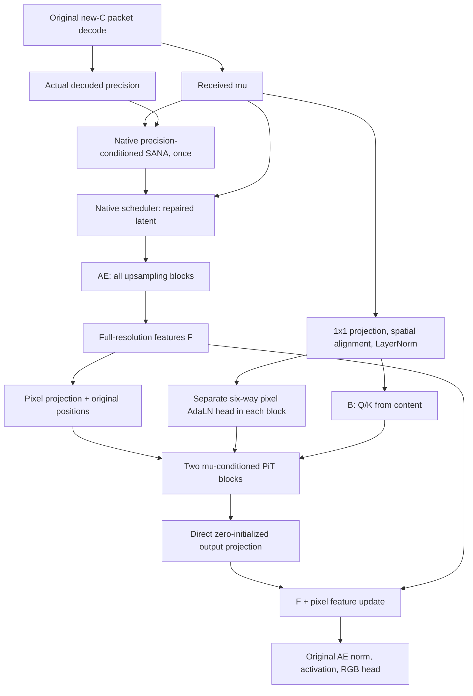

# New C + mu-conditioned LayerNorm PiT (A/B)

The subsequent user-requested precision extension of B is documented in
[New C + B with additive precision AdaLN](NEW_C_MU_PIT_PRECISION.md).

Implements the 2026-11-01 specification. B is the main candidate: received mu
drives Q/K and per-pixel AdaLN, while AE pixel features provide V. A is a
matched control: mu drives the same AdaLN, but compact pixel features provide
Q/K/V. These structures have not established a reconstruction-quality gain.

## Baseline and preserved numerical fixes

The branch builds on `0b9ac12`, whose parent `4a0e582` already ports
`de13052138e8061db0bd8c783fc67393344ab43a`. This retains FP32 math SANA
cross-attention, stable LPIPS normalization, overflow-safe gradient clipping,
bounded identical-update FP32 replay and complete checkpoint recovery.
`perceptual.py`, `training_precision.py` and the three de13052 numerical test
files are unchanged relative to that repair. Existing linear-attention guards,
complete decoder-tail/perceptual checkpointing, saved-tensor policies and
auxiliary-optimizer handling are preserved as well. See
[the existing numerical audit](NEWC_COMBINED_NUMERICS_20261030.md).

These fixes address the diagnosed failure mechanisms; they cannot guarantee
that a new training run will never encounter a numerical failure.

## Architecture



D takes only F and canonical received mu (`view["mean"]`), with mu before AE
scaling. Delta still conditions C and SANA. D does not consume delta, raw SANA
hidden, a generator-update condition or the v2 precision gate.

At 512x512: mu is 32x16x16; F is 128x512x512; each PiT region is 16x16
pixels, so the region grid is 32x32. Mu passes through Conv2d(32,256,1),
bilinear interpolation (`align_corners=False`), flattening to 1024 region
tokens and LayerNorm(256). This content is computed once and shared by the two
blocks, whose Q/K projections and AdaLN heads are independent.

Pixel input is Linear(128,16) per position, plus the existing pixel sinusoidal
positions. Every block retains the six-way input AdaLN:

```text
shift_a, scale_a, gate_a, shift_m, scale_m, gate_m = pixel_AdaLN(content)
P = compact(LayerNorm(X) * (1 + scale_a) + shift_a)
B: Q = Wq(content), K = Wk(content), V = Wv(P)
A: Q = Wq(P),       K = Wk(P),       V = Wv(P)
Q, K = existing_2D_RoPE(Q, K)
attention = Wo(softmax(Q K^T / sqrt(head_dim)) V)
X = X + gate_a * expand(attention)
X = X + gate_m * pixel_MLP(LayerNorm(X) * (1 + scale_m) + shift_m)
```

Compaction is 4096->256, expansion 256->4096; attention has four heads of
width 64. Pixel MLP is 16->64->16 with GELU. The six-way head emits distinct
parameters for each of the 256 pixels per region, using the existing
`[region, pixel, six groups, channel]` layout. There is no per-head Q/K norm.
All D norms are ordinary affine LayerNorm along the final channel dimension,
eps=1e-6. Pretrained AE norms are untouched. There is no extra output norm.

After both blocks, unpack pixels and use Linear(16,128) directly, adding its
feature residual to F before the original AE norm/activation/RGB convolution.
Only this final projection's weights and bias start at zero. Internal
Conv/Linear/attention/MLP/AdaLN parameters retain their normal PyTorch defaults;
LayerNorm scale/bias start at one/zero. Internal residual gates are not zeroed.
This preserves C at initialization and opens inner gradients after normal
optimization of the output projection.

A and B use identical dimensions, projections, parameter count and seeded
initialization; only the Q/K input changes. Their separate decoder method names
and persistent source-identity buffer reject accidental cross-mode loading.
Each production-width D has 17,377,456 trainable parameters.

## Configuration and initialization

| Mode | Recipe | Decoder method |
| --- | --- | --- |
| A, entry control | `configs/bt_self_flow/precision_v3/mu_pit_a_joint.yaml` | `precision_consistent_mu_adaln_pixel_adapter_v3` |
| B, main | `configs/bt_self_flow/precision_v3/mu_pit_b_joint.yaml` | `precision_consistent_mu_qk_pixel_adapter_v3` |

Both inherit native C's data, quality/rate pairs, losses, trainability, optimizer
and LR schedule. Training remains 200K joint updates, batch 8, accumulation 1,
seed 903; six qualities; 4 MSE + 1 LPIPS + 1 DISTS, base latent weight 0.1,
repaired latent weight 0; SF disabled. Codec is not additionally frozen.
Gradients through mu remain enabled. Complete export/EMA/resume includes D.

Use the same new-C shared backend initialization for both modes, rather than
continuing a trained H28-PiT or v2 D. Explicit shared initialization ignores
any old D state inside backend_init, retaining this model's newly initialized
D. Normal deployment and resume require the complete matching architecture
and mode; no partial old-D load is allowed. Existing C/PiT methods remain
available with their original config and state contracts.

For this host, a launch example for B is below; implementation does not launch
this research run or choose/interrupt a training GPU:

```bash
export DITIC_DATA_ROOT=/data1/ls/data
export DITIC_SANA_PATH=/data1/ls/pretrained/pretrained/Sana_600M_1024px_diffusers
export DITIC_TEXT_PATH=/data1/ls/pretrained/pretrained/fixed_text_embed_gemma.pt
export TORCH_HOME=/data1/ls/pretrained/pretrained/torch
export NEWC_MU_PIT_RUN_ROOT=/data1/ls/code/runs/newc_mu_pit
python train_bt_self_flow.py \
  --config configs/bt_self_flow/precision_v3/mu_pit_b_joint.yaml \
  --init-checkpoint /data1/ls/code/runs/newc_pit_gpu0_20261029/backend_init.pt
```

Switch only the config to `mu_pit_a_joint.yaml` for A. Default output directories
are separate A/joint and B/joint. If using `--run-root`, the existing trainer
overrides that suffix, so provide a distinct run root per mode. Compare matched
successful update counts and actual total bpp, using the existing
`eval_bt_self_flow.py` for PSNR, MS-SSIM, LPIPS and DISTS.

## Checks and condition interventions

`tests/test_mu_pixel_adapter.py` covers both modes: normalization and attention
source contracts, matched initialization, zero initial writeback, subsequent
gradients through Q/K/V/AdaLN/MLP and mu, full decoder checkpoint recomputation
in FP32/BF16, constructor/RNG preservation, one native SANA call, six unchanged
packet qualities, independent-process receiver decoding, optimizer/EMA and
strict mode boundaries, exact trainer continuation and two-rank checkpointed
DDP. The existing de13052 numerical tests also remain in the regression suite.

Production-width adapter checks can be run with either A or B:

```bash
python scripts/check_pixel_adapter.py --scope adapter \
  --config configs/bt_self_flow/precision_v3/mu_pit_b_joint.yaml \
  --device cpu --updates 2 --output /tmp/mu_pit_b_check.json
```

The existing `--scope full --init-checkpoint ...` preflight also supports both
methods. Adapter-only checks do not measure full pretrained batch-8 GPU memory
or RD quality; schedule the full preflight before the research run.

For a trained checkpoint, use:

```bash
python scripts/diagnose_mu_pit.py --checkpoint /path/to/checkpoint.pt \
  --input /data1/ls/data/Kodak --crop 512 --limit 8 --qualities 0.2 0.6 \
  --output /tmp/mu_pit_diagnosis.json
```

This decodes the real packet once, caches the actual AE feature F immediately
before D, and replays only D and the original RGB tail. Interventions use
normal, zero, wrong-image same-quality and spatially shifted mu, plus bypass D.
The formal SANA input/output and AE features stay fixed. Reports include paired
4 MSE + LPIPS + DISTS, its change from normal, output RMSE in [0,1], four RD
metrics and the recipient's actual total bpp. Fixed-size center crops keep
wrong-image mu on the same grid. Wrong-image decoding uses only its codec,
without another SANA prediction for the intervention.

Useful conditioning requires correct mu to improve original-image distortion
reproducibly; merely changing the output is insufficient. Zero/swap tests are
distribution-shift interventions, not retrained ablations. Whether B is stably
better than A must be decided by matched training and actual-bpp RD results;
adopt A if that experiment does not support B.

## Validation completed on 2026-11-01

- CPU regression: **167 passed, 11 skipped**, including new A/B integration,
  native/previous PiT methods, real packets, independent-process decoding,
  exact trainer continuation, two-rank Gloo DDP, numerical recovery and the
  discriminator contract. Skips were GPU/opt-in upstream-reference checks.
- GPU supplement: **55 passed**, covering both modes' FP32/BF16 checkpoint
  forward/backward and the de13052 attention, perceptual and recovery tests.
  Forward remains bit-exact; CPU gradient parity remains exact. CUDA gradient
  comparisons allow atol=1e-8, rtol=1e-4 for backward accumulation rounding.
  In the seeded CUDA comparison the maximum FP32 parameter-gradient difference
  was 1.46e-11; BF16 gradients were identical.
- Production-width A and B each passed two CPU AdamW updates on
  `[1,128,512,512]` features. Initial writeback was exactly zero and every
  checked Q/K/V, AdaLN, MLP and content projection had finite, nonzero gradients
  after the first update. Reports: [A](validation/newc_mu_pit_a_adapter_cpu_20261101.json),
  [B](validation/newc_mu_pit_b_adapter_cpu_20261101.json).
- An independent subagent reviewed the architecture, common receiver path,
  initialization, checkpoint/EMA boundaries and condition interventions, and
  ran **9 passing targeted CPU checks**. No blocking issue was found.

The full pretrained batch-8 GPU preflight and research training were not run.
These checks establish implementation behavior, not memory capacity for that
run or a measured RD gain. Machine-readable validation details are in
[the validation record](validation/newc_mu_pit_validation_20261101.json).
