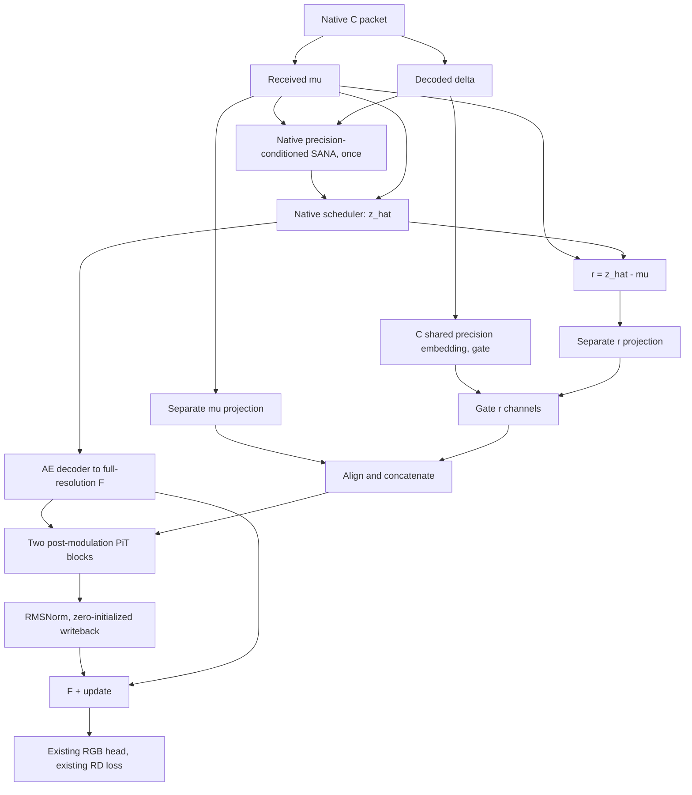

# New C + receiver/update-conditioned PiT v2

This implements the agreed next D experiment. It is an AE-internal pixel
adapter on precision-consistent C, using received content, the actual SANA
update and the existing coding precision. Self-Flow remains disabled.
Implementation checks do not establish rate-distortion gains.

## Baseline and numerical fixes

The implementation starts from `4a0e582`, which already ports the numerical
fixes of `de13052138e8061db0bd8c783fc67393344ab43a` to the existing new-C/PiT
branch. `de13052` need not be cherry-picked again. The preserved fixes include:

- FP32 math SDPA for SANA cross-attention, including its backward path.
- Stable FP32 LPIPS feature normalization with compatible weights.
- FP64 norm reduction when individual gradients are finite but their FP32
  global norm overflows.
- Bounded identical-update FP32 replay before optimizer/EMA advancement, and
  complete recoverable state.

The existing linear-attention denominator guards, complete AE/PiT-tail and
perceptual checkpointing, stride-preserving CPU storage option, auxiliary
optimizer handling and diagnostic hooks are retained. See
[the numerical repair audit](NEWC_COMBINED_NUMERICS_20261030.md).

## Task insight and information boundaries

The ordinary AE decoder receives the repaired endpoint `z_hat`. Explicitly
preserving `mu` (the received base) and `r = z_hat - mu` (the generator's actual
update) gives the pixel stage access to that decomposition. This adds no source
information, and the two conditions may still prove redundant with the main
AE features. Whether the interface helps reconstruction is an experiment.

`mu` is not ground truth, `r` is not the true compression error, and `delta`
is neither pixel uncertainty nor an instruction to modify coarse cells more.
The receiver constructs everything from the unchanged C v3 packet and one
native SANA prediction. No source latent, planner activation or raw final-layer
SANA hidden is used as a PiT condition.



## Implemented condition interface

Both latents use the canonical AE coordinates **before** division by the AE
scaling factor. `r` is computed by FP32 subtraction of the actual scheduler
endpoint and `mu`, without changing the scheduler output. For the current
scheduler it equals `-sigma * v`, rather than unscaled velocity `v`.

1. Divide both inputs by C's existing fixed `s_data`.
2. Apply separate bias-free 1x1 projections, each 32 to 128 channels.
3. Bilinearly align the two projected grids to the PiT region grid, with
   `align_corners=False`.
4. Reuse `codec.precision_embedding(log(delta))`, then apply a pointwise
   `128 -> 128 -> 128` MLP, with a SiLU middle activation.
5. Form `g = 1 + 0.5 * tanh(gate_logits)`. The last gate layer starts at zero,
   so `g=1` initially. Nearest-neighbor alignment retains coding-cell boundaries.
6. Use `SiLU(concat(mu_feature, g * r_feature))` as the 256-channel condition.

There is no sample/token normalization of mu/r, no early sum, no additional
precision embedding, and no projection bottleneck after concatenation. Before
the final nonlinearities, scaling `r` scales its feature branch correspondingly;
a zero update produces a zero update feature. No proportionality is promised
for the final RGB output. The gate is a learned bounded feature adjustment.

For a 512-square image, mu/r are `32 x 16 x 16`, delta is `1 x 8 x 8`,
the aligned condition is `256 x 32 x 32`, and F is `128 x 512 x 512`.
Rectangular images use their actual two-dimensional grids.

## PiT and initialization

The adapter uses two blocks, pixel width 16, regions of 16x16 pixels,
attention width 256, four attention heads and a pixel MLP ratio of four.
It retains pixel sinusoidal positions, Q/K RMSNorm, 2D RoPE, softmax SDPA,
temporary region-token compaction/expansion, pixel residuals and pixel GELU MLPs.

Each block follows the official four-way post-modulation implementation:

```text
A = expand(attention(compact(RMSNorm(X))))
X = X + (1 + scale_attention(c)) * A + shift_attention(c)
M = pixel_MLP(RMSNorm(X))
X = X + (1 + scale_mlp(c)) * M + shift_mlp(c)
```

The condition head produces distinct parameters for every pixel in each region;
its reshape order is `[region, pixel, four parameter groups, channel]`.
Four-way heads start at zero, following the upstream C2I initialization.
Attention and MLP remain active through the initial `1 + scale` factor.
Mu/r projections use Xavier initialization.

Final readout is `RMSNorm(16) -> Linear(16,128)`, followed by a feature residual
add to F and the existing norm/activation/RGB head. The output linear layer is
zero-initialized. This preserves native C initially. The successive zero exits
mean that condition and gate gradients activate over several normal updates;
all inner gradients need not be nonzero at the first backward.

The adapter has **13,199,232 parameters**, excluding the already shared C
precision embedding. This is an instantiated count, not a throughput claim.
PiT math is adapted from official revision
`f5ed1f6014c93def68bba38866b8da4077e6f678` (PR #8); see
[upstream provenance](../third_party/PixelDiT/SOURCE.md).

## Configuration, state and training

Use `configs/bt_self_flow/precision_v3/pixel_v2_joint.yaml`, which selects
`precision_consistent_received_update_pixel_adapter_v2`. Native C and both
legacy PiT methods/configurations remain available. The internal packet backend
is still C; the research idea D is selected by `decoder.method`.

The recipe inherits C's data, six quality/rate pairs, objective, trainable
backbone/LoRA policy, optimizer and 200K joint schedule. It uses batch 8,
accumulation 1, seed 903, GPU-resident saved tensors and the original validation
cadence. Image losses are 4 MSE + 1 LPIPS + 1 DISTS; base latent NMSE weight
is 0.1 and repaired-latent loss weight remains zero. No SF or extra condition
loss is introduced. Main RD gradients pass through mu/r and the shared precision
embedding normally. Validate at actual total bpp.

PiT parameters belong to the existing pixel-adapter optimizer group, at the
backend learning rate. Export, strict load, deployment EMA and exact trainer
resume include the full adapter. `s_data` and the precision embedding remain
owned and checkpointed by C, with no duplicate state inside PiT.

Initialize from the same new-C shared `backend_init` as the old PiT experiment.
For an explicit shared handoff, v2 ignores any v1 PiT state in that shared
checkpoint and keeps its own freshly initialized adapter. Ordinary v2
deployment/resume uses strict loading and rejects old PiT states. The trainer
also distinguishes the new method in its strict resume contract.

Example using the existing local assets and handoff; this command has **not**
been launched as a research run:

```bash
export DITIC_DATA_ROOT=/data1/ls/data
export DITIC_SANA_PATH=/data1/ls/pretrained/pretrained/Sana_600M_1024px_diffusers
export DITIC_TEXT_PATH=/data1/ls/pretrained/pretrained/fixed_text_embed_gemma.pt
export TORCH_HOME=/data1/ls/pretrained/pretrained/torch
export NEWC_PIT_V2_RUN_ROOT=/data1/ls/code/runs/newc_pit_v2
python train_bt_self_flow.py \
  --config configs/bt_self_flow/precision_v3/pixel_v2_joint.yaml \
  --init-checkpoint /data1/ls/code/runs/newc_pit_gpu0_20261029/backend_init.pt
```

Choose the CUDA device via the existing environment/launcher when actually
scheduling the experiment. This implementation does not reserve a device.

## Verification and next experiment

`tests/test_received_update_pixel_adapter.py` covers condition amplitude and
spatial alignment, real-library native-C parity, one generator call, official
post-modulation forward/backward parity, full decoder-tail recomputation,
FP32/BF16 gradients, shared-state ownership, all six real packet qualities,
independent-process receiver decoding, strict old/new state boundaries, EMA,
complete trainer resume and two-rank zero-initialized checkpointed DDP.

Production-width adapter preflight:

```bash
python scripts/check_pixel_adapter.py --scope adapter \
  --config configs/bt_self_flow/precision_v3/pixel_v2_joint.yaml \
  --device cpu --updates 4 --output /tmp/pit_v2_adapter_check.json
```

Validation completed on 2026-10-30:

- Combined CPU/Gloo regression: **130 passed, 5 skipped**. It includes new/old
  PiT, new C, attention/perceptual/recovery fixes, complete recomputation,
  trainer/backend/evaluation and the GAN discriminator contract. The skips
  are five CUDA cases in this explicitly CPU-only invocation.
- Separate CUDA FP32/BF16 checkpointed v2 adapter parity: **2 passed**.
- Official pre-modulation and post-modulation forward/backward comparisons
  both passed against the fixed upstream source.
- Production-width 512-square CPU adapter, four AdamW updates: passed with
  exact zero-initialized feature parity and subsequently active gradients in
  both blocks, both content projections and the precision gate. The report is
  [checked into the repository](validation/newc_pit_v2_adapter_cpu_20261030.json).

The regression command, using the cached perceptual weights and a temporary
checkout of the pinned official source, was:

```bash
TORCH_HOME=/data1/ls/pretrained/pretrained/torch \
CUDA_VISIBLE_DEVICES='' GLOO_SOCKET_IFNAME=lo \
PIXELDIT_REFERENCE=/tmp/ditic-pixeldit-official-20261030 OMP_NUM_THREADS=1 \
python -m pytest -q \
  tests/test_received_update_pixel_adapter.py tests/test_pixel_adapter.py \
  tests/test_precision_pixel_adapter.py tests/test_c_precision_v3.py \
  tests/test_c_precision_v3_validation.py tests/test_bt_attention_precision.py \
  tests/test_bt_perceptual_precision.py tests/test_bt_precision_recovery.py \
  tests/test_bt_recompute.py tests/test_bt_training.py tests/test_bt_backend.py \
  tests/test_bt_evaluation.py tests/test_gan_discriminator_contract.py
```

`--scope full --init-checkpoint ...` is also compatible with the new method
for a scheduled pretrained-model preflight. It performs engineering updates,
not a research run. The production-width CPU check uses a random feature
objective; it does not validate full pretrained RD or production batch-8 GPU
memory. Those still need the real scheduled full-model preflight.

The research comparison must include actual-bpp RD against C and old PiT.
To diagnose the condition, keep the formal SANA endpoint and AE feature fixed,
and intervene only on the PiT r argument: zero, half/double, wrong-image r or
spatially displaced r. Also compare a fixed unit gate and bypassed PiT. Report
both output changes and distortion against the original image. Sensitivity
alone does not demonstrate useful conditioning. A matching trained no-r
ablation is the primary extra run if the complete candidate succeeds.
