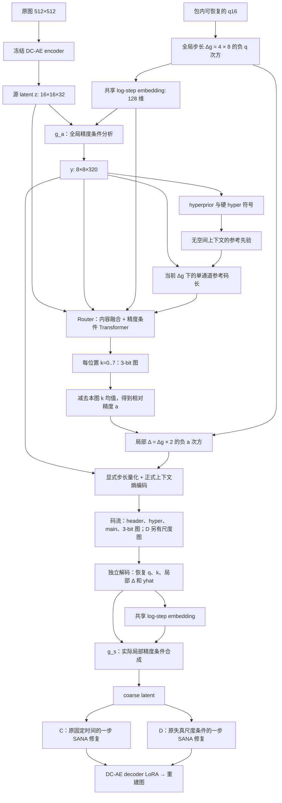

# C precision v2：完整精度条件前端与 C / C+D 配对训练

本版本保留显式量化步长和 Router 空间分配，把同一条“精度坐标”接到分析、分配和合成三个环节。它实现完整训练、真实码流、独立解码、EMA、断点恢复及评测；工程测试通过不等于已经证明相对历史 baseline 的 RD 收益。

## 当前设备安排：V100 训练 C+D，5090 训练 C

2026-10-22 更新：两张 V100 共同训练 D（即 C+D），两张 5090 训练 C。使用 `run_c_precision_single.sh`，每卡 batch8 / accumulation1 的共同 warmup 仍为 50K；两卡 E2E 自动改为每卡 batch2 / accumulation2，保持有效 batch8 和 200K 更新数。下文 `run_c_precision_pair.sh` 则保留原来同机两卡各训一组的用法。

V100 的实际输出根目录为 `/data2/ls/checkpoints/c_precision_v2_D_v100_20261022`。先在 V100 完成新 50K warmup 和 EMA 标定，生成唯一的 `backend_init.pt`；将它复制到 5090，C 从同一文件开始 E2E。这样避免两种 GPU 各自 warmup 的数值差异混入前端初始化对照。

```bash
# V100：完整双卡预检后，自动 warmup → 共享初始化 → 双卡 D E2E
"$BT_PYTHON" scripts/preflight_bt_self_flow.py \
  --config configs/bt_self_flow/precision_v2/common.yaml \
  --backend D --gpus 0,1 --smoke --output /新的预检目录
bash scripts/run_c_precision_single.sh D 0,1

# 5090：配置本机资产 / 数据路径，并复制 V100 生成的 backend_init.pt 后
export BT_RUN_ROOT=checkpoints/c_precision_v2_C_5090
bash scripts/run_c_precision_single.sh C 0,1 --shared-init /复制到本机的/backend_init.pt
```

`--shared-init` 校验 phase、模型、质量表、标定结果和公共资产哈希；允许公共资产在不同机器上有不同路径，保持权重身份验证。将相同文件原子发布到本次 run root 后直接进入 E2E，不重复 warmup。没有 `--shared-init` 时，启动器会从新 warmup 开始。

共享初始化和有效 batch 对齐后，跨 V100 / 5090 的 FP16 / BF16 数值路径仍有差别；应在报告中记录硬件和精度，不能称为同数值环境的严格单变量对照。

## 相比旧 C 改了什么

| 环节 | 旧 C | 本版本 |
| --- | --- | --- |
| 分析变换 | 所有 q 共用相同分析，Router 输入也不随 q 重新计算 | 全局 log Δ 的共享 embedding 条件化 g_a；每个 q 重新分析 |
| Router 内容融合 | 源 latent、分析特征、成本投影直接相加 | 源与分析特征分别投影、归一化，再做保留分析支路的非线性融合；单通道成本在输出前加入 |
| Router 精度条件 | 无当前 q 条件 | 同一全局精度 embedding 调制每层 Transformer 的注意力与前馈归一化，能改变内容相关的相对决策 |
| Router 初始化 | 连续码 3.5，正好落在 3/4 分界 | 连续码约 4，位于档位中心；微小非零输出权重使首步梯度能进入内容分支 |
| 训练码率梯度 | 在硬符号上估计概率 | 重建和上下文仍用硬 STE 符号；仅 R 的概率估计用归一化残差加 U(-0.5,0.5) |
| 合成变换 | 不显式知道实际局部步长 | 从包内 q16 和 3-bit 图恢复实际 log Δ，使用同一个 embedding 条件化 g_s |
| latent 约束 | 部分旧实验 base / repaired 均为 0 | 保留 coarse 的 base NMSE，repaired NMSE 只记录、不反传 |
| 训练协议 | 旧配置存在 Router 开启与质量范围渐进 | 只有 50K warmup、200K e2e，两阶段从首步使用完整六档和完整 Router |

这里不强制八档均匀占用。是否有效，要看内容和 q 是否改变分配、梯度是否正常、最终真实码率下重建质量是否改善。只用两档本身不能单独证明失败；新实现也不能保证训练后八档全被使用。

## 数据流与可解释的控制量



全局控制与空间分配分别承担两件事：Δg 决定整体量化精度，Router 决定同一图内哪里更精、哪里更粗。正式公式为

```
s_i = 3.5 × (tanh(u_i) + 1)
k_i = round_STE(s_i)                    # 0..7
a_i = (2/7) × (k_i - mean_image(k))
Δ_i = Δg(q) × exp(-ln(2) × a_i)
```

3.5 来自把 [-1,1] 映射到 [0,7]；2/7 是原八档相对精度网格的间距。较大的 k 表示较小的步长。相邻档位的步长比例约为 1.219。减去均值让每张图局部步长的几何均值仍为 Δg，避免 Router 整图抬高或降低精度来替代全局控制。模型内部仍可重缩放特征，所以这并不构成绝对 bpp 预算保证。

共享 embedding 输入是实际 log Δ，而非另建一张可学习码率表：g_a / Router 使用 log Δg，g_s 使用 log Δ_i。g_a 在 pre1 后、g_s 在上采样后接零初始化仿射残差；Router 在每层注意力和前馈归一化处接零初始化条件投影。初始变换为恒等，条件头有梯度后逐步学会不同精度下的表示。解码端不用运行 g_a、Router，也不用原图、参考成本或 clean latent。

### Router 三种输入如何处理

1. z 的相邻 2×2 重排成 8×8×128，再用 1×1 投影到 128 维，保留原始局部内容。
2. y 从 320 通道投影到 128 维，表达待压缩表示；z / y 各自 LayerNorm 后，`h = y_proj + MLP(concat(y_proj,z_proj))`。
3. 两层 Transformer 在全局精度条件下处理内容。最后把 `log1p(cost)` 这一维拼入决策头，而非与内容向量直接求和。

cost 是当前 q 下，用 hyperprior 给出的**无已解码空间上下文的参考先验**估计的局部主 latent 码长：`sum_channels(-log2 P(round((y-mean)/Δg); scale/Δg))`。它不等于最终上下文编码长度，也不代表语义重要性；只提供“当前位置在当前精度下可能昂贵”的提示。该计算共享现有先验权重，无反传、不增加发送字节、不跑第二个 codec；最终 R 仍来自正式上下文模型。未引入额外相对成本、损伤图、候选压缩或事后教师选择。

### 码流与 D 的衔接

q、分配图和熵模型共同重建局部步长，编码和解码使用同一 canonical q16。格式沿用 BT 包，读取时仍需匹配相应模型 checkpoint。

| 完整图尺寸 | Router 3-bit 图 | D 额外 4-bit 尺度图 | 固定头 |
| --- | ---: | ---: | ---: |
| 512×512 | 24 B | 32 B | 55 B |
| Kodak 512×768 | 36 B | 48 B | 55 B |

上述字节、hyper 和 main 均进入总 bpp。新增精度条件不发送额外特征。D 沿用现有真实 residual RMS 的尺度量化、条件调制和局部一步更新；这不是把步长直接当作真实失真。尺度上下界在 warmup 完成后，用训练数据和共享 **EMA 前端**标定；标定是统计计算，没有第三段训练。C / D 载入同一份 EMA codec 和同一份公共后端初始化，只有 D 新增自己的条件器。

## 完整训练配置

配置入口是 `configs/bt_self_flow/precision_v2/{common,c_joint,d_joint}.yaml`。启动器会把解析后的全部配置、代码提交、设备和 Python 路径冻结到输出目录的 `manifest.json`，阻止静默修改实验。

| 参数 | 50K latent warmup | 200K C / D e2e，各自计步 |
| --- | --- | --- |
| GPU | 两张 5090，DDP | C 一张、D 另一张，同时训练 |
| 每卡 batch / 累积 | **8 / 1** | **2 / 4** |
| 全局有效 batch | **16** | **8** |
| 裁剪 | 512×512 | 512×512 |
| 训练模块 | codec、Router、精度条件、熵模型 | 以上 + DiT LoRA128、VAE decoder LoRA32、文本投影；D 另有条件器 |
| 目标 | `base_NMSE + λ(q)R` | `4MSE + LPIPS + DISTS + 0.1base_NMSE + λ(q)R` |
| repaired loss | 0 | 0；只记录 NMSE |
| main LR | 全部 1e-4 | 全部初始 1e-4 |
| main LR 计划 | 常数 | 100K ×0.5，160K 再×0.2，190K 再×0.1 |
| 熵分位数 aux LR | 1e-3 | 1e-3，不随 main scheduler 衰减 |
| AdamW | betas=(.9,.999)，weight decay=0 | 同左 |
| 梯度裁剪 | 4 | 4 |
| EMA | .999 | .999 |
| 精度 | 5090 原生 BF16；codec / 熵路径 FP32 | 同左；V100 短程测试用 FP16 + GradScaler |
| 质量选择 | 每次成功 optimizer update 等概率采样一个六档 q；全 rank / 累积共享 | 同左，C / D 共享计数器序列 |
| 验证 / 保存 | 每 2K / 每 10K，完成和暂停另存 | 同左 |

| q | 0 | .2 | .4 | .6 | .8 | 1 |
| --- | ---: | ---: | ---: | ---: | ---: | ---: |
| Δg | 4 | 2.639 | 1.741 | 1.149 | .758 | .5 |
| λ(q) | 32 | 16 | 8 | 4 | 2 | 1 |

两阶段使用同样 Δg、六档采样和 λ，无额外 `rate_weight=3`。目标覆盖 0.01–0.1 bpp，这是待训练验证的起始超参数，不能由公式直接保证。完成 warmup 时会检查真实码率和质量跨度，未通过则停止交接，不自动改超参数。旧 V100 / 5090 warmup 缺少新接口，不能无缝作为本次 warmup 使用。

数据仍为 DIV2K / Flickr2K / LSDIR / CLIC professional。`base_NMSE = mean((coarse-z)^2)/s_data^2`，s_data 从 512 个训练样本固定估计；D 的尺度范围用 512 个训练样本覆盖六档标定。后端和输入不使用窗口、滑窗或 tile；SANA / decoder 的 activation checkpoint 只用于重算节省显存。

Kodak24 每 2K 用 EMA、完整图、六档、真实总字节评测 PSNR / MS-SSIM / LPIPS / DISTS；通常每档抽两图校验序列化后解码，每 10K / 最终 200K 检查全部图。TensorBoard 和 JSONL 同时记录各项加权 loss、q / λ、LR、Router 梯度和码分布。最后 200K EMA 是预定主结果，best checkpoint 另行保存，不替代最终步数比较。

历史 512 baseline 的 4/1/1 图像权重、有效 batch8、200K 预算和 LR 计划被对齐；但它与本次的 λ 范围、base 约束、前端、数值精度及实际数据环境仍有差异，因此属于系统对照，不能写成只改 Router 的单变量消融。C vs D 才是本版本严格配对的增量比较。

## 5090 上启动

拉取本分支，在现有可用的 5090 PyTorch 环境安装缺少的依赖。不要用 V100 的 torch wheel 覆盖 5090 环境。测试环境版本记录在 review 文档。

```bash
git switch codex/c-precision-closed-loop-20261022
export BT_PYTHON=/你的5090环境/bin/python
export DITIC_DATA_ROOT=/你的数据根目录
export DITIC_SANA_PATH=/你的SANA权重目录
export DITIC_TEXT_PATH=/你的fixed_text_embed_gemma.pt
export TORCH_HOME=/你的torch缓存目录
export BT_RUN_ROOT=checkpoints/c_precision_v2_5090
```

数据根目录下应保持配置中四个训练集的子目录名称和 `Kodak/`；路径布局不同可在本分支配置中改路径并提交。先执行完整模型短程检查，输出目录必须是新的：

```bash
"$BT_PYTHON" scripts/preflight_bt_self_flow.py \
  --config configs/bt_self_flow/precision_v2/common.yaml \
  --gpus 0,1 --smoke --output /你的新目录/c_precision_preflight
```

该检查用真实 512 模型和感知损失运行 14 步双卡 warmup，然后 C / D 各 14 步 e2e，并检查暂停恢复、码流和吞吐；缩短标定样本数且关闭未训练模型的质量跨度门槛，仅用于工程验证。生产配置仍为 512 样本标定并启用跨度检查。

检查通过后，在 tmux 中启动正式配对流程：

```bash
bash scripts/run_c_precision_pair.sh 0,1
```

自动先双卡训练共同 50K warmup、生成 `backend_init.pt`，然后两张卡各运行 C / D 的 200K。暂停时对启动器发送 SIGINT / SIGTERM，等待它保存完；用完全相同命令恢复。已存在的 run root 不能混用代码提交、数据或设备配置。

两张 V100 留作收到 checkpoint 后的完整图评测；本提交不会停止或接管已有训练。独立评测示例（C 或 D 各跑一次）：

```bash
CUDA_VISIBLE_DEVICES=0 "$BT_PYTHON" eval_bt_self_flow.py \
  --checkpoint "$BT_RUN_ROOT/C/joint/complete.pt" --weights ema \
  --input "$DITIC_DATA_ROOT/Kodak" --output results/c_precision_C_200k \
  --sana-path "$DITIC_SANA_PATH" --text-path "$DITIC_TEXT_PATH" \
  --save-images --check-forward
```

跨机器允许映射公共权重路径，但会继续校验权重哈希。BD-rate 只在共同质量区间积分，不作外推；比较时应使用同一完整图 / 真实码流协议。

## 测试与代码检查

详见 [C_PRECISION_V2_REVIEW.md](C_PRECISION_V2_REVIEW.md)。增加的测试覆盖非恒等条件、真实 rANS、六档、独立进程解码、内容条件梯度、噪声 R / 硬重建分离、两卡更新、EMA 别名、共享初始化、断点恢复、CUDA AMP。完整模型检查脚本为 `scripts/check_c_precision_full.py`，可以在 CPU 上执行实际公共 SANA / DC-AE 和 512 感知损失前后向；它不是收敛或 RD 收益测试。测试依赖清单为独立的 `requirements-c-precision.txt`，其中 peft / pyiqa 与旧清单不同。
