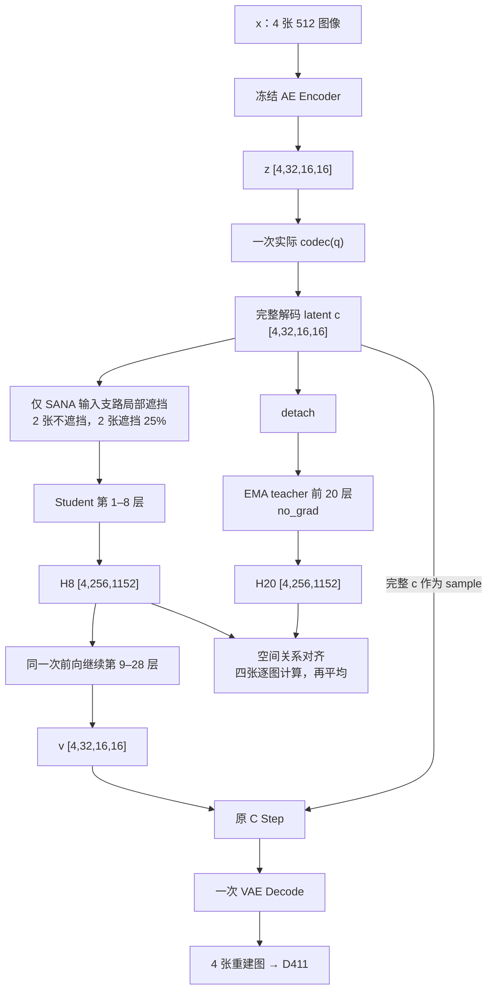

# 下一版 C + SF：一次 student 前向，同时重建与对齐

状态：2026-10-27 根据用户最新约束重新设计，取代同目录两次 student 前向的建议。研究方案，尚未实现、预检或切换现有训练。

> 联动设计修正：下面新增的“用真实重建检验 SF，再由 RD 决定编码”小节，取代本文此前把直接开放 SF→codec 当作默认配置的建议。一次 student 前向、完整 C skip 和原始主损失等约束不变；尚未实现或验证新的任务有效性判据。

## 用真实重建检验 SF，再由 RD 决定编码

用户提出的关键问题是正确的：teacher 更深或拥有更多信息，不足以说明其全部特征值得让前端花 bit 模仿。“SF 误差大”也不等于“给该处多分 bit 会改善最终重建”。

此次将联动拆为两个有共同任务依据的部分：

1. SF 改善同一次完整 student 重建中实际使用的表示；teacher 的建议用真实 D411 判断，而不是预设其永远正确。
2. 编码器、router、g_s 和熵模型首先只接受真实 C 主 RD 的梯度。后端得到改善后，真实 RD 对量化、内容和分配参数的梯度随之变化，前端据此学习传什么、传多少。SF 直接更新 codec 仅作为后续受控消融，不作为本次默认。

前端目标仍然是：

    J_front = D411(x_hat,x) + beta(q)*R_total + 0.1*base

对于局部量化步长的连续训练近似，其边际信号为：

    dJ_front/dlog(delta_i)
      = dD411/dlog(delta_i)
        + beta(q)*dR_total/dlog(delta_i)
        + 0.1*dbase/dlog(delta_i)

这里是训练代理及其 STE 的导数，不是离散码流的精确边际 bit 收益。实际 router 还有全图中心化、上下文组编码和 g_s 的空间混合，因此不能把单个 SANA token 的 SF 误差直接当作某一个编码单元的码率分配标签。必须通过真实计算图传播，再用实际 packet RD 核实。

预期机制是：若 SF 使后端能利用上下文补偿某类量化损失，减少这类信息所带来的最终失真代价会下降，原 RD 就有机会减少对应的付费信息；无法补偿且影响重建的内容仍然值得编码。这是待验证的联动路径，不是额外保证，当前方法也有经共享参数和 RD 产生的间接联动，不能把这一基础机制单独当成新颖性。

### Teacher 建议的任务有效性检查

同一次完整 student 前向同时读取 H8^S 和 H20^S；teacher 仍只前向到 H20^T，不增加第二次完整 student 或第二份训练重建。

    g20_i = stopgrad(dD411/dH20^S_i)
    d_i = stopgrad(H20^T_i - H20^S_i)
    u_i = - dot(g20_i, d_i)

u_i 是一个自推导的一阶量：在固定当前尾部和完整 C skip 的情况下，将 student 的第 20 层第 i 个 token 朝 teacher 移动一个足够小的正步长，预测 D411 的变化为 -epsilon*u_i。它比较的是第 20 层与第 20 层，不把 H8 和 H20 的通道直接相减。

- u_i>0：teacher 这一方向有降低当前重建损失的局部迹象。
- u_i<0：这一方向在当前模型和样本上预计有害。
- 接近数值噪声或 g20 接近零：缺少有用建议的证据，不能以较深、较清楚为由强行对齐。

u_i 目前先作为机制诊断；不能在未验证它与真实小步干预的关系前，就把它包装成已经有效的动态 SF 权重。一个可检验的后续候选是仅使用 u_i>0 且超过实测数值噪声的行做关系对齐。四张图均读取 H8/H20、评估 teacher；不承诺每一张图每一次都必须有非零对齐梯度。是否采用这一选择器，需由短诊断决定。

需固定同一份 c 和 student 尾部，检查：

    x_hat_epsilon = decode_tail(H20^S + epsilon*(H20^T-H20^S), sample=c)

它只是预检中局部步长的干预，不是常规训练的第二份重建或部署功能。EMA 坐标漂移、较大的特征变化、LPIPS/DISTS 非线性都可能使一阶估计不可靠。即使 u_i 为正，也不证明“让 H8 的关系更像 H20”一定会在完整网络里产生上述有益方向；这个跨层转移仍必须实测。

这一诊断可复用主任务 backward 保留下来的 H20 梯度，无需 create_graph 或二阶导数。为了实现按 loss 路由的参数更新，需要主 RD backward 与仅针对后端参数的 SF 梯度累加；“一次 student 前向”不意味着“没有额外反向计算”。保留计算图和 checkpoint 重算的显存、耗时须预检。不能简单 detach 整个 student 输入，否则主 RD 对前端的梯度也会被错误切断。

### 最关键的反证

若后端 SF 对齐更好，但在固定 checkpoint、固定数据和受控编码干预下，减少付费信息造成的真实 D411 增量没有改善，那么“SF 让前端可以少发 bit”的论点没有成立。仅看梯度范数、teacher 比 student 深或辅助 loss 降低都不够。

短诊断应分别核实 teacher 的任务建议、完整 student 对 SF 特征的使用，以及真实编码 RD 的响应。所有码率干预都需通过现有解码合同，保留 q、router 全图中心化和实际上下文编码的影响；不能把 router 码置零解释为只删掉一个局部区域。当前运行已有阶段性正收益，也不以其已失败为前提替换实验。

## 补充复核：为什么改，以及证据有多强

随后补核了当前运行的 20K、22K、24K 评测，而不是只依据 18K。按此前相同的 log(total bpp) 插值办法：22K 相对纯 C 的平均 PSNR +0.07858 dB、LPIPS -0.001931；24K 为 +0.008085 dB、LPIPS -0.0002377。24K 高码率区间仍有 LPIPS/DISTS 的劣势。结果见 `latest_comparison_20000_24000.json`。这是单次运行、Kodak24 的均值曲线，未做显著性检验；当前版本尚无稳定收益，但也不能据此认定它已经失败或长训必然无效。此前从 18K 结果推断其长期前景，判断偏早。

不同改动的理由不能混为一谈：

- 一次完整 student 前向、全部四张对齐：首先满足用户的计算要求，使监督落在同一次真实完整重建图的 H8 上；它本身不是画质提升的证据。
- 取消 P 和跳层读出：减少训练目标被专用头或替代读出路径吸收的可能；不代表主网络一定使用 SF 学到的维度，亦不代表预测头原则上错误。原始 Self-Flow 本身就使用预测头。
- 空间中心化关系目标：受 iREPA 的空间结构分析及 DINOv3 的 Gram 方法启发；本系统中公共分量是否主导 cosine、teacher 的结构是否有用，仍未测实。因此“原 cosine 太容易”是待验证解释，不是已确证的失败原因。
- 直接开放 SF→codec 的梯度曾作为候选：它提供直接影响付费表示的机会，同时可能鼓励冗余和涨 bpp。经此次联动复核，改为后续消融，默认由真实主 RD 更新前端。当前前端未接受 SF 梯度并不等于当前 SF 完全不能通过共享 SANA 改善重建。
- 同 q、局部遮挡 teacher/student：主要是省掉第二档 codec 并使信息差可控，不具备“必然优于高 q teacher”的理论保证。高码率 teacher 是合法的训练期特权信息，不额外增加部署码率。换成同 q teacher 会失去这份额外信息，且均值遮挡引入训练推理差异，是本版最不确定的改动。25% 与半 batch 仅是起始工程选择，不是已验证最优值。

本方案属于一次新的可检验假设，不能称为当前实验失败后的必然修复。主张的创新也不能只是 dropout 加 Gram：只有实际证明有限 bit 表示和上下文利用得到改善，并在同总 bpp 上优于纯 C，才能建立压缩收益的论点。

## 不可变的计算约束

每卡 batch=4 时：四张图各运行一次完整 student，产生四张重建图，同时读取这一次计算图中的四份 H8；四张图全部与 EMA teacher 的 H20 对齐。没有另一个混合 student 前向，没有辅助 VAE 重建，没有 P 或跳层辅助读出。

teacher 仍须另做 no_grad 的前 20 层前向，这部分计算不能消除。两卡各自拥有 student 和冻结 teacher；teacher 可按 2+2 分块前向以降低峰值激活，但全部四张图片都有 teacher 目标。

## 主张：同一份已解码信息上的局部缺失预测

真实 codec 只运行一次，按源 C 抽到的 q 得到 c。teacher 看完整的 detach(c)，student 的 SANA 输入分支对少量位置做局部内容遮挡。两者使用同一份实际码流能提供的信息；不再另算 q_b，不混入未计费的更高质量编码。

teacher 的信息优势来自 student 被遮掉的位置与深度 8→20；它不能提供实际码流已丢失的任意纹理。这是刻意缩小目标范围，使学习目标更符合部署条件。

## 张量路径

按每卡 B=4、512 输入：

    x [4,3,512,512]
      → frozen AE encoder
    z [4,32,16,16]
      → codec(q): g_a、router、量化/熵模型、g_s
    c [4,32,16,16]

三个用途全部复用这一份 c：

1. student 的 SANA 输入 c_s；
2. 原 C scheduler 的完整 sample/base；
3. teacher 的 no_grad 输入 detach(c)。

局部内容遮挡：每卡随机选两张做 25% token 的遮挡，其余两张不遮挡。所有四张仍同时计算重建和 SF，不是只有两张参与 SF。每步重新选择图片与空间位置，与 q 无关。

    c_mean = mean_HW(c)                       # [4,32,1,1]
    M ∈ {0,1}^[4,1,16,16]
    c_s = (1-M)*c + M*c_mean                  # [4,32,16,16]

未遮挡图片的 M 全为 0。遮挡图片的 M 有 64/256 个 1，位置内全部通道同进同出。采用图像自身的每通道空间均值作为内容填充值，保留全局统计；不抹去模型内部的位置、时间或文本条件，不学习新的 mask token。

    v, H8 = student_full_28_layers(c_s)       # 恰好一次 student 前向
    v:   [4,32,16,16]
    H8:  [4,256,1152]
    z_hat = original_C_step(v, sample=c)      # 基底是完整 c，不是 c_s
    x_hat = shared_VAE_decode(z_hat / scale)  # [4,3,512,512]，一次重建

teacher：

    with no_grad():
        H20 = EMA_SANA_prefix20(detach(c))    # [4,256,1152]

teacher 包括目标需要的 EMA SANA 和条件投影，但无需额外 EMA codec、AE encoder 或 VAE decoder。全程同 q、同一份 c；没有 q_H 或第二条 codec 编码分支。

## 单次前向意味着什么

不能同时要求“完整 student 输入完全未扰动”和“这一次同一层特征已经经历局部输入扰动”。在不增加 student 分支的约束下，局部遮挡必须进入这次重建前向。

本版把它限定在 SANA 的输入支路；完整 c 仍作为原 C skip/sample 进入最终重建。未遮挡的半个 batch 继续提供完全正常的 C 前向。这样是训练增强，不能声称训练与推理没有分布差异；推理时关闭 M，走标准 C。

## SF 目标

继续验证空间关系目标，而不是原始向量 cosine 或 teacher-minus-student 的微小残差。无需预测头：

    Z(H) = H - mean_tokens(H)
    K(H) = Z(H) Z(H)^T / (mean_i ||Z(H)_i||^2 + eps)

K 的形状为 [4,256,256]，FP32。对 student 和 stopgrad teacher 的非对角关系计算相对平方误差，分母为相同监督位置上的 teacher 关系平方均值加 eps。

每张图片分别算一次 SF：未遮挡图片监督所有行，遮挡图片监督 M=1 的行与全图其他位置的关系；排除对角线。再对四张图取平均，全部四张参与。teacher 若中心化关系能量贴近数值噪声，不通过放大分母继续训练。

目标是促使被遮挡位置利用上下文形成与完整输入相似的结构关系；正常图片同时接受深浅层关系约束。关系损失本身已有先例，本版不以“发明关系损失”为创新主张。

## 唯一的主损失

    D411 = 4 MSE(x_hat,x) + LPIPS(x_hat,x) + DISTS(x_hat,x)
    L = beta(q)*R_total + 0.1*base(c,z) + D411 + ramp*1.0*L_SF

删除上一版的额外 D_mix。四张图片只有一次图像损失，沿用原 C 的 4/1/1、base 和码率定义；repaired-latent loss 为 0。

R_total 来自实际 codec(q) 的量化与熵模型，包括原有边信息；评测仍用真实完整 packet 总 bpp。训练期熵似然不是算术编码后的精确字节数。遮挡 M 不传输，推理时也不使用。

重建梯度：codec、SANA 和 VAE 的原有可训练参数。SF 梯度：先只更新 SANA 前八层及其条件投影的原有可训练参数；teacher 无梯度。前端保持由主 RD 裁决，SF 直接到 codec 的版本作为消融。完整 c 的主 skip 不受遮挡，codec 的 rate 与 base 仍针对真实原生表示。两种梯度需按 loss 路由，不能用一个普通联合 backward 冒充这一梯度合同。

无论后续是否开放 SF 梯度到 codec，都不保证更节省 bit；即使仅通过图像重建梯度，codec 也可能为抗遮挡学习冗余。原始 rate 约束和同总 bpp 验证不可省略。

## 配置

- 从用户上传的源纯 C 10K 完整 checkpoint 重新开始，保留优化器、EMA、LR、样本计数与源 C 的 iid 六档质量抽样。
- 沿用源 C 架构和已有 codec precision-v2 conditioning，不增加 SANA 质量 conditioner。
- 512，双卡每卡 4、积累 1，有效 batch 8；必要时每卡 2、积累 2。后一种配置每个微批随机一张遮挡、全部样本计算 SF。
- SF 外层权重最终 1，teacher EMA decay 0.999。
- 10K→12K 使用同一个 ramp：SF 系数从 0 到 1，受遮挡图片的 token 比例从 0 到 25%。没有额外 warmup 或预测头准备阶段。
- 推理时 M=0，关闭 teacher 和关系计算，完整恢复普通 C 路径。
- 保留已有 AMP/FP32 稳定性修复、源 C 的主损失与 LR。V100 FP16 与源 BF16 的差异仍须记录。

## 实施与短试判据

实现应从实际单次完整 C 前向捕获 H8 与用于任务诊断的 H20，不能为了 capture 再跑一遍前八层。R、base 和图像损失各计算一次，四张图片都拥有一一对应的 teacher 目标；主 RD 与仅限后端的 SF 梯度分别累加，统一执行一次 optimizer step。

先检查：

1. M=0、SF=0 时输出与源 C 一致；关闭本机制不会留下额外 decoder 模块。
2. 每个微批完整 student 调用计数=1、VAE 调用计数=1；teacher 无 VAE，四张图全部参与 SF。
3. CStep 的 sample 精确来自 c，teacher 看的是 detach(c)，没有免费高质量 latent、额外原生 student 前向或 D_mix。
4. H20 关系有图像内容，正确图、错图、空间打乱目标可区分；H8/H20 的差距不能只来自数值噪声。
5. 真实 512 双卡 forward/backward、梯度归属和保存恢复通过；显存与吞吐实测，不承诺固定加速比例。

通过后先做 10K→14K/16K 短试，与已有纯 C 在相同步数、相同真实总 bpp 比较低中高码率。若只有辅助目标改善、teacher 关系退化或主 RD 持续恶化，不直接长训。

已有纯 C 判断整套配方是否更好；要把收益归因于 SF，还需要同样遮挡但关闭 SF 的对照。这是对结果解释的要求，不在本次设计阶段启动第二个实验或本地纯 C 训练。

本版相对上一份建议，省掉第二次 student 重建、辅助 VAE 和第二档 codec；teacher 从半 batch 改为全 batch，因此总耗时不会等同纯 C，具体加速仍需测量。
